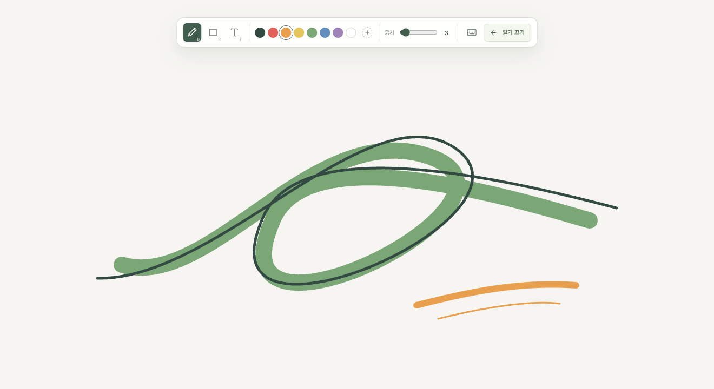

# My Brush

**보고 있는 화면 위에 바로 쓰고, 설명하고, 다시 작업으로 돌아오는 데스크톱 필기 앱.**

My Brush는 다른 앱 위에 투명한 필기 화면을 띄웁니다. 웹페이지, 문서, 발표 자료를 보며 선으로 강조하고, 사각형으로 영역을 짚고, 짧은 설명을 덧붙일 수 있습니다. 별도 작업 공간으로 옮기지 않고 지금 보고 있는 화면에서 생각을 나누는 도구입니다.

## 이런 순간에 사용합니다

- 화면을 공유하면서 상대가 봐야 할 부분을 선과 사각형으로 표시할 때
- 문서나 화면을 함께 검토하며 짧은 의견을 화면 위에 남길 때
- 설명을 마친 뒤 필기를 잠시 숨기고 원래 앱에서 작업을 이어갈 때

## 할 수 있는 일

| 기능 | 설명 |
|---|---|
| 자유 필기 | 화면 위에 선을 그리고 색상과 굵기를 조절합니다. |
| 사각형 | 설명할 영역을 테두리로 표시합니다. |
| 텍스트 | 여러 줄의 설명을 넣고 내용·색상·글자 크기를 다시 편집합니다. |
| 영역 삭제 | Control+드래그 영역에 닿은 획·사각형·텍스트를 오브젝트 단위로 지웁니다. |
| 필기 켜기 / 끄기 | 전역 단축키나 메뉴로 필기와 일반 작업을 오갑니다. 숨긴 필기는 다시 켜면 돌아옵니다. |
| 단축키 설정 | 전역 토글과 도구 전환 키를 손에 맞게 바꿉니다. |

필기 내용은 실행 중에만 유지되고 **앱을 종료하면 사라집니다.** 파일 저장·내보내기, Undo/Redo, 기기 간 동기화는 현재 제공하지 않습니다.

## 로컬에서 동작합니다

계정이나 서버 연결 없이 로컬에서 실행합니다. 필기 내용은 메모리에서 관리하고, 색상·굵기·단축키 같은 설정만 기기에 저장합니다. 입력 문제 진단은 텍스트·좌표·일반 키를 제외한 제한된 기록을 로컬에 남깁니다. [저장 데이터 안내](docs/guide/usage.md#저장되는-데이터)에서 자세히 확인할 수 있습니다.

## 더 알아보기

- [사용 안내](docs/guide/usage.md) — 필기 시작, 도구와 단축키, 설정·데이터
- [개발·빌드 안내](docs/development.md) — 소스 실행, 자동 검사, 앱 패키징
- [첫 버전 요구사항](docs/requirements/first-version.md) · [입력 설계](docs/design/interaction-design.md)
