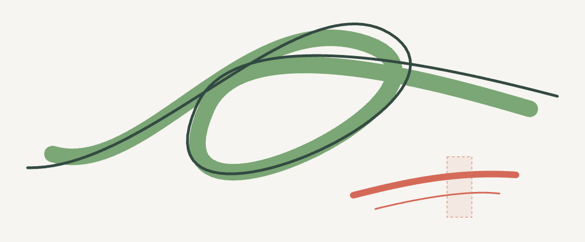
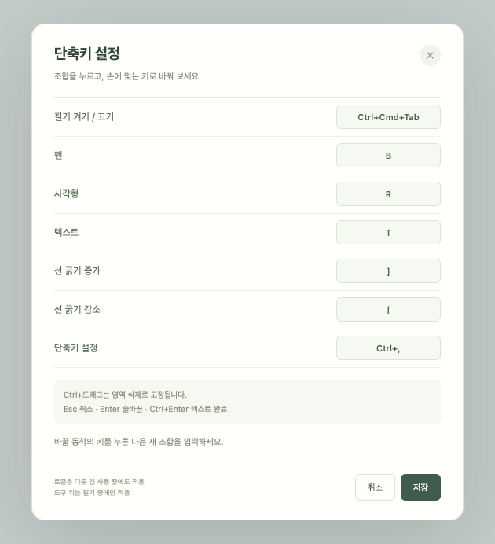

# My Brush 사용 안내

My Brush는 다른 앱 화면 위에서 펜·사각형·텍스트로 설명을 덧붙이는 데스크톱 앱입니다. [앱 소개](../../README.md)와 [소스 실행·빌드 안내](../development.md)도 참고하세요.

## 필기 시작과 작업 복귀

앱을 실행하면 투명 필기 화면과 도구 막대가 나타납니다. 필기 화면이 켜진 동안에는 My Brush가 화면 입력을 받습니다. 원래 앱을 조작하려면 도구 막대의 **필기 끄기**, 전역 단축키, 앱 메뉴를 사용합니다.

| 동작 | 기본 입력 |
|---|---|
| 필기 켜기 / 끄기 | macOS: Control+Command+Tab · Windows: Control+Shift+Space |
| 펜 / 사각형 / 텍스트 | B / R / T |
| 선 굵기 감소 / 증가 | [ / ] |
| 단축키 설정 | Control+, |
| 영역 삭제 | Control을 누른 채 왼쪽 버튼으로 드래그 |
| 텍스트 줄바꿈 / 확정 | Enter / Control+Enter |
| 현재 편집·제스처 취소, 그 외 작업 복귀 | Escape |

**macOS에서도 Control은 ⌃ 키입니다.** Command(⌘)와 구분합니다. 도구 키는 필기 중에만 적용하며, 텍스트 편집 중에는 문자 입력에 사용합니다. 저장된 사용자 단축키가 있으면 기본값보다 우선합니다.

필기를 끄면 도구 막대와 필기 내용이 함께 숨겨집니다. 다시 켜면 완료한 필기가 돌아옵니다. 앱 활성화만으로는 필기를 다시 켜지 않으며, 단축키·메뉴·앱의 두 번째 실행으로 켭니다. 앱을 완전히 종료하려면 메뉴의 **My Brush 종료**를 사용합니다. 종료하면 필기 내용은 사라집니다.

## 펜·사각형·텍스트

- 펜으로 드래그하면 한 획을 만듭니다. 색상은 기본 8색과 직접 선택을 지원합니다.
- 사각형은 채움 없는 테두리입니다. 선 굵기는 1~32이며 새 펜 획과 사각형에 적용됩니다.
- 텍스트 도구로 빈 곳을 클릭하면 여러 줄을 입력합니다. 글자 크기는 12~144입니다.
- 텍스트 도구로 기존 텍스트를 클릭하면 내용·색상·크기를 다시 편집할 수 있습니다. Escape는 편집 전 상태로 되돌립니다.
- Enter는 줄바꿈, Control+Enter는 확정입니다. 편집기 밖 필기 영역을 클릭해도 확정하며 그 클릭은 새 필기를 만들지 않습니다.

기본 글꼴은 OS 기본 산세리프를 사용하므로 macOS와 Windows의 글자 모양·줄 폭은 다를 수 있습니다.

현재 화면 오른쪽·아래 끝에 텍스트를 입력하면 확정 후 잘릴 수 있습니다. 가장자리에서 여유를 두고 입력하세요. [데스크톱 검증 기록](../design/native-verification.md)을 참고하세요.

## 영역 삭제

Control을 누른 채 필기 영역을 왼쪽 버튼으로 드래그합니다. 삭제 영역과 일부라도 닿은 **한 획·사각형·텍스트 전체**가 버튼을 놓을 때 삭제됩니다. 겹친 부분만 깎아내지는 않습니다. 채움 없는 사각형의 빈 내부만 선택하면 테두리를 지우지 않습니다.

Control을 먼저 놓거나 Escape를 누르거나 포커스를 잃으면 미완료 삭제를 취소합니다. 도구 막대·설정 창·텍스트 편집기 위에서는 삭제를 시작하지 않습니다.

## 단축키 설정

도구 막대의 키보드 버튼 또는 Control+,로 설정을 엽니다. 바꿀 동작의 버튼을 누르고 새 조합을 입력한 뒤 저장합니다. 취소하면 기존 설정을 유지합니다.

단독 보조키, 중복 조합, 고정 입력과 충돌하는 조합은 저장하지 않습니다. 전역 단축키 등록·설정 저장에 실패하면 기존 조합을 유지합니다. 최초 실행에서 OS가 전역키 등록을 거절하면 앱 메뉴를 통해 필기를 켜고 설정에서 다른 조합으로 변경하세요.

Control+드래그, Escape, 텍스트의 Enter·Control+Enter는 고정 입력입니다.

## 저장되는 데이터

| 데이터 | 저장 방식 |
|---|---|
| 필기·사각형·텍스트 | 실행 세션 메모리. 종료 시 사라짐 |
| 색상·선 굵기·텍스트 크기·단축키 | Electron 사용자별 `userData`의 `preferences.json` |
| 입력 문제 진단 | 같은 디렉터리의 `input-diagnostics.jsonl`. 최근 보고 최대 32건 |

기본 설정 디렉터리는 macOS `~/Library/Application Support/My Brush/`, Windows `%APPDATA%\My Brush\`입니다. 개발·검사에서 `MY_BRUSH_USER_DATA`를 지정하면 해당 경로를 사용합니다.

진단은 입력 취소 사유, 버튼·Control 상태, 포커스 등 허용된 메타데이터만 기록합니다. 필기 텍스트, 좌표, 일반 키, 바탕화면 캡처를 저장하거나 외부로 전송하지 않습니다. 앱에 계정·클라우드 동기화 기능은 없습니다.

새 설정 파일이 없을 때만 이전 Python·Qt 버전 설정을 읽어 이전하며 원본은 유지합니다. 이전 경로는 macOS `~/Library/Preferences/MyBrush/MyBrush/preferences.json`, Windows의 로컬·로밍 앱 데이터 아래 `MyBrush/MyBrush/preferences.json`입니다.

## 검증 범위

이 안내의 Windows 조작은 구현된 입력 규칙입니다. Windows 실제 실행, 물리 전역키·한글 IME, 혼합 배율·전체 화면 앱에서의 결과는 [데스크톱 검증 기록](../design/native-verification.md)의 미확인 항목과 구분합니다. 캡처 방식은 [이미지 안내](../images/README.md)에 기록합니다.
